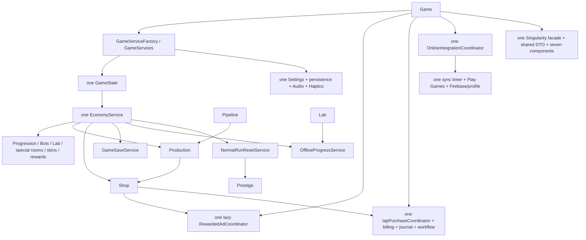

# Final architecture and regression audit

Audit date: 2026-10-11. Branch: `refactor/services`, audited refactor tip `d5461be` against local `main`. Initial working tree was clean. No remote fetch or Android device execution was performed. This report includes the uncommitted fixes made during the audit; those fixes must accompany the merge.

## 1. Branch status and complete commit review

`main...refactor/services`: **0 behind, 11 ahead**. Committed branch diff: **116 files, 7,059 insertions, 4,626 deletions**; **80 added, 34 modified, 2 renamed, 0 deleted**. The complete added-file inventory is in the appendix. Large changes are Game (708 changed lines), SingularityService (2,551), its seven extracted components, settings/audio, ShopController and the new regression harnesses.

| Commit | Purpose / systems | Regression surface and scope findings |
| --- | --- | --- |
| 69ec10b | Move cosmetic, settings and reward composition out of GameUiController | Constructor side effects, texture/audio startup order, injected versus compatibility construction. Architecture and documentation. |
| 2b3c885 | Settings/Singularity navigation fixes and access-code toast presentation | Modal hit testing, room background preservation, removed CENTER button and sector CURRENT badges, changed code feedback. **Mixed UI behavior changes; not architecture-only.** Debug grant amount and unlock reward unchanged. Requires explicit device acceptance of these UI changes. |
| ab86d8e | Add GameServices and GameServiceFactory | Single-instance ownership, service initialization order, UI references. Architecture. |
| e25c678 | Route currency transactions and spending statistics through EconomyService | Every debit/refund/reward path, bulk spending aggregation, earned/run/stat distinctions. Architecture; numeric behavior retained. |
| d2b4c23 | Centralize sequential-room eligibility and unlock quotes | Removal of deferred event-wrapper guard, direct service calls, Singularity prerequisite, previews versus mutation-time eligibility. Existing production gates retained. |
| e73c9d7 | Extract normal offline settlement and deterministic clock seam | Research completion split, temporary boost overlap, mobile pause/resume, historical income selection. Adds tests and excludes test sources from the game project. |
| f9182b9 | Extract save snapshots, hydration and migration into GameSaveService | All saved fields, legacy version gates, lifetime-level migration, ordering before offline settlement. Adds GameSave harness. |
| d41dbe5 | Decompose Singularity behind its existing facade | Matter transactions, sector grid, nodes/cores, bot durability, formulas, offline and persistence. 65 extracted method bodies matched after mechanical dependency translation; constants also matched. Adds tests. |
| 93544b3 | Separate settings persistence, preferences, audio and haptics | Independent settings schema/defaults, music lifetime, Master mute, static input compatibility. Adds Settings and SettingsAudio coverage and WAV fixture link. |
| 649d505 | Extract normal-run reset ownership | Prestige threshold/count, slot/bot/cycle reset, lifetime levels and permanent retained data. Adds Prestige oracle tests and script UIDs. |
| d5461be | Extract ad/IAP and online orchestration | SDK callback lifecycle, paid grant durability, journal replay, timer registration, score semantics, overlays. **Intentional safety behavior changes**: durable journal, overflow rejection, duplicate/stale callback guards, failed-save/ledger completion gates. No balance or integration configuration changes. |

Reviewed the whole commit range, including intermediate changes and numeric additions/removals, rather than just the final integration commit. No game asset changes, deleted scripts, or native integration configuration changes were found. The SettingsAudio fixture is the only added asset reference.

Persistence changes: GameSaveService, OfflineProgressService, Singularity persistence extraction, SettingsPersistenceService/GameSettingsData, Economy routing in independent cosmetic stores, billing ledger completion result and new grant journal. Main and independent DTO contracts were compared with main. Integration changes: AdMob adapter/coordinator, IAP workflow/journal/coordinator, Game.Integrations, online coordinator/profile/sync workflow/service, Shop/IAP and username/leaderboard UI wiring. Native adapters and first-party IDs remain unchanged, except the audited billing safety fixes described below.

## 2. Build

`dotnet build`: **PASS, 0 errors, 339 warnings** on a full compilation after the fixes. The initial build had the same counts. Incremental success must not be described as a warning-free full build. Godot.NET.Sdk 4.7.2, game target net9.0; standalone harnesses use net10.0.

## 3. Complete automated results

All seven projects discovered recursively under `tests/` were built and executed before fixes, and executed again after the final code changes. Counts are assertions, not independently discovered xUnit/NUnit test cases.

| Suite | Result | Final assertions | Coverage / runner |
| --- | --- | ---: | --- |
| GameSave | PASS | 3,416 | Mapping, hydration, version boundaries and migrations; Godot headless |
| Integrations | PASS | 206 | Ads, IAP ordering/retries/journal, ledger corruption, sync fanout, main structural corruption/backup protection; Godot headless |
| OfflineProgress | PASS | 663 | Offline interval/research/boost arithmetic and lifecycle; standalone dotnet |
| Prestige | PASS | 37,568 | Reset/retention, frozen baseline oracle, levels/rewards and independent stores; Godot headless |
| Settings | PASS | 47 | Preference persistence/defaults, sound/haptic wiring; standalone dotnet |
| SettingsAudio | PASS | 10 | Real WAV resolution, player ownership, playback/restart/mute; Godot headless |
| Singularity | PASS | 213 | Formulas, bots, sectors/nodes, legacy save/offline, corrupt-store lock and failed temp write; Godot headless |

Total: **42,123 assertions**. No failing suite. No test expectation was weakened. Godot runs used separate `/tmp/final-audit-final-user-<suite>` XDG data roots; real player files were untouched. Test sources named `Program.cs.txt` are intentionally included explicitly by their csproj files. Native Android SDK/server behavior is not covered by these harnesses.

Reproduction: run `dotnet build`; for OfflineProgress/Settings use `dotnet run --project tests/<suite>/<suite>.csproj --no-restore`; for the other five use `dotnet build tests/<suite>/<suite>.csproj --no-restore`, then `XDG_DATA_HOME=/tmp/<isolated-profile> godot-mono --headless --path tests/<suite>`. Build/run evidence for this audit is under `/tmp/final-audit-*.log` and `/tmp/final-audit-final-tests.json` on this workstation.

## 4. Warnings

| Warning | Classification / disposition |
| --- | --- |
| 339 game CS8632 | Harmless known first-party annotation-context warnings across existing data, services, UI and Game partials. Baseline phase-1 documentation records 351; extraction has reduced the count. No blanket suppression or nullable-policy change. A full nullable-contract audit is separate work. |
| Singularity harness CS0436 | Generated Godot `Main` initializer conflicts with imported game initializer; generated test initializer is selected. Third-party/generated warning, execution passes. |
| SettingsAudio shutdown ObjectDB/resource messages | All 10 assertions pass and process exits 0, but Godot reports WAV/playback references still in use at immediate headless shutdown (2–4 objects, one resource). Verbose rerun identified AudioStreamWAV/AudioStreamPlaybackWAV; this is a test teardown/runtime limitation, not a proven gameplay leak. No warning suppression. Check long-session audio lifecycle on device. |
| Test restore/build NU1900 | Environment/package vulnerability-feed lookup failed. Restore was retried with authorized network access and still reported the same warning; packages restore/build/run successfully from the available cache. Security advisory lookup was therefore **not verified**. |

No compile errors or additional first-party warning category requiring a behavior fix was found. No obsolete compatibility warning was reported by the compiler.

## 5. Gameplay and balance comparison

**No gameplay balance changes detected.** This refers to valid-game balance, not the documented UI and failure-safety changes.

| Balance category | Before → after / evidence |
| --- | --- |
| Room and slot unlock costs | Identical RoomCatalog/GameConfig and Economy quote formulas |
| Machine upgrade costs, production and cycle durations | Identical MachineData/ProductionService and existing Economy calculations |
| Bot multipliers, rarity chances and resale | Identical BotCatalog/GameConfig; BotService rarity/refund formulas retained |
| Bot repair and durability | Full repair fraction 0.20 → 0.20; lifetime definitions and consumption unchanged |
| Research costs, durations and multipliers | ResearchCatalog/LabData identical; Lab completion clock is injectable without changing arithmetic |
| Shop costs, upgrades and boosts | GameConfig/ShopData identical; only transaction delegation changed |
| Level rewards | Interval 150 → 150; reward 10 Shards → 10 Shards |
| Prestige threshold | 1e18 earned run Tokens → 1e18 |
| Prestige multiplier | Identical PrestigeData exponential formula, softcap 20 and configured maximum |
| Singularity unlock | 50,000,000,000,000,000 Tokens → same |
| Singularity Matter costs/node scaling | Identical extracted build/upgrade/sector formulas |
| Singularity core scaling/production | Unlock `250 × 4^(sector−1)`; output `0.05 × 1.42^(level−1)` and sector factor `1 + 0.35 × sector`, unchanged |
| Singularity offline efficiency/cap | 0.50 → 0.50; seven days → seven days |
| Refund fractions | Singularity node/bot 1/3 → 1/3; normal refund formulas unchanged |
| Rewarded ads | 5 Shards → 5 Shards |

GameConfig, RoomCatalog, BotCatalog, ResearchCatalog, MachineData, PrestigeData, ShopData, ProductionService and IapCatalog were byte-identical to main. Singularity constants were matched by name/value; all 65 extracted block-bodied methods checked matched after dependency qualification and currency-delegation translation. Facade construction, Update, Unlock, Load and Save were separately reviewed. There is no numerical retuning hidden in the extraction.

## 6. Save compatibility

**PASS for supported historical/current saves.** Main SaveVersion remains **21**. SaveGameData, RoomSaveData, SlotSaveData, PipelineSaveData, InfrastructureSaveData, QuantumSaveData, StatsSaveData and Singularity DTO definitions are byte-identical to main: no renamed property, changed type, removed field or incompatible default. Independent settings DTO moved from private to public type but retains the same JSON properties/defaults/version. Unknown-property handling remains the existing serializer behavior.

| Migration | Verified retained behavior |
| --- | --- |
| Pre-v13 | Initial Data Shards fallback |
| Pre-v14 | First/previously unlocked room rewards treated as claimed |
| v16 | Pipeline restoration gate; earlier versions reset |
| v18 | Infrastructure restoration gate; earlier versions reset |
| v19 | Quantum restoration gate; earlier versions reset |
| Pre-v20 | Highest claimed level reward defaults to zero |
| Pre-v21 | Lifetime base lower bound from historical reward milestone after Prestige |
| Historical offline income | Pre-v19 recomputation and legacy pre-v15 boost correction helper retained; no unreachable legacy branch deleted |
| Bot durability / Singularity pre-v3 | Existing initialized-flag durability migration and legacy first-core mapping retained |

SaveManager was unchanged in the committed refactor. The audit intentionally adds a narrow null room/slot structure check before declaring a read successful, allowing the existing backup path and LastLoadFailed protection to handle those malformed files. Main/backup/temp paths, UTF-8 without BOM, temp writer flush, `Flush(true)`, backup preservation, rename, autosave interval **10 seconds**, failure lock, delete behavior and overwrite protection are otherwise unchanged. Current/missing-field valid DTOs retain their defaults. Negative/invalid numeric policy was not redesigned.

Independent stores remain separate: settings, bot skins, machine skins, IAP ledger, IAP journal and Singularity. Current first-party paths:

| Store | Active / auxiliary paths under user:// |
| --- | --- |
| Main | idle_ai_save.json; idle_ai_save.bak.json; idle_ai_save.tmp.json |
| Settings | idle_ai_settings.json; idle_ai_settings.tmp.json |
| Bot skins | idle_ai_cosmetics.json; idle_ai_cosmetics.tmp.json |
| Machine skins | idle_ai_machine_skins.json; idle_ai_machine_skins.tmp.json |
| IAP ledger | idle_ai_iap_ledger.json; idle_ai_iap_ledger.tmp.json |
| Grant journal | idle_ai_iap_grant.json; idle_ai_iap_grant.json.tmp (derived by appending .tmp) |
| Singularity | singularity_save.json; **singularity_save.tmp.json** (audit-added atomic-write staging path) |

The unchanged addon sample additionally uses `user://sample_admob_settings.cfg` from its GDScript/C# sample implementations, outside the production Game path. The Play Games addon documentation mentions `user://image.png` as an example, not a runtime game store.

No conflicting owners/paths. The coordinator intentionally reads/fingerprints the main save path; that is not a second main-save writer. Journal recovery delegates its write to SaveManager. Singularity version stays 4 and its JSON options remain indented/case-insensitive.

## 7. IAP safety

Reviewed GooglePlayBillingService → IapPurchaseCoordinator → IapGrantWorkflow → ShopService/Economy → Game.TrySaveGame/SaveManager → IapGrantJournal → billing ledger/consume, and IapShopController notification wiring.

The actual durable order is: purchased-state/supported-product/token validation; `Math.Max(1, quantity)` and checked long-sized amount; journal prepare with flushed temporary file; one runtime grant; prospective main-save journal proof; successful flushed main save; journal confirmation; token insertion and **durable ledger write**; consume request; journal cleanup. Ledger persistence is inside CompleteConsumableGrant and precedes consumption. UI receives a successful completion only afterward.

One-process deduplication uses billing processing/processed token sets, coordinator token dictionary, workflow granted/completed sets and reentrancy guards. Failed main saves retain the runtime-granted token and reservation; later successful saves or purchase intent retry saving/finalization without regrant. A failed ledger write removes its tentative processed token and never requests consumption. Unknown products, missing tokens, pending/unpurchased state and overflowing reward amounts do not grant. Additional ready tokens queue behind the single durable reservation.

**Fixed:** corrupt ledger previously became an empty set, risking replay of an unconsumed already-paid token and replacement of valuable ledger evidence. Billing now exposes LedgerLoadFailed, validates the persisted token-list structure, refuses callbacks/purchase/completion when locked, and the coordinator blocks recovery/saves. Incomplete journal DTOs and malformed confirmation hashes now fail closed. Main LastLoadFailed and journal RecoveryBlocked both gate saves/grants; recovery establishes main corruption state before replay.

| Exact crash point | Expected restart |
| --- | --- |
| 1. Callback before prepare | No runtime/persisted reward. Owned-purchase query when billing initializes can deliver the token again. |
| 2. Prepare before runtime grant | Journal identifies the before-save fingerprint; recovery writes its prospective reward snapshot once, durably records token, then clears. Runtime hydration follows. |
| 3. Runtime grant before main save | Runtime state is lost on process death. Same journal replay as point 2 restores exactly one reward. |
| 4. Main save before billing completion | Reward/current or previous-confirmed fingerprint is recognized; recovery does not regrant/overwrite recognized later gameplay. It persists the token and retries completion. If ledger write fails, journal/files remain blocked for a later restart. |
| 5. Billing completion before journal delete | Durable ledger already contains token. Recovery only cleans journal. Any still-owned token is consumed when billing reconnects; it does not grant again. |

Unrecognized histories/corrupt files intentionally stop automatic recovery rather than guess. Restoring unrelated old main/ledger backups independently is not a supported transaction rollback. Corruption may require support/manual recovery; do not delete a ledger/journal merely to unblock the shop. Native consume acknowledgments and callbacks require Android validation. Billing remains initialized by IAP UI startup; no native initialization is required for journal recovery.

## 8. Rewarded ads

**PASS at the policy/adapter wiring level.** Shop construction does not initialize AdMob. First video intent initializes/loads; another tap when ready shows. Exact reward is 5 Shards via ShopService.GrantDataShards. Per-show earned guard is set before grant/observers; generation and showing guards reject duplicates and old handles. Dismiss without earned callback and failures grant nothing; terminal callbacks invalidate the generation. Successful dismissal destroys and loads the next ad; repeated presses cannot show the same handle twice. Exit disposes/invalidate callbacks. Android/iOS unit IDs and platform choice match main. Native callback ordering remains a P0 device check.

## 9. Play Games

One OnlineIntegrationCoordinator creates one achievement adapter and one PlayGamesSyncService. Initialization guards prevent a duplicate one-second timer. Sync continues receiving shared GameState/Progression. Official Level gets total lifetime level; Prestige gets PrestigeCount, with existing clamping/deduplication. Achievement predicates, all achievement and leaderboard IDs, plugin name and initialization are byte-identical to main. The autoload/native addon settings did not change. Platform-unavailable adapters remain no-ops; workflow isolates sync exceptions. Authentication, confirmations and exported plugin availability need device verification.

## 10. Firebase

FirebaseConfig, FirebaseAliasService and its leaderboard partial are byte-identical to main. Endpoints, project/client identifiers, alias/profile collection names, authentication exchange/refresh, username validation/reservation and score semantics are unchanged. OnlineProfileService forwards the same events and calls; the overlay still receives the top list and own ranked entry. Score sync retains authenticated/username and in-flight/change guards; it does not request a top list every timer tick.

First-party config contains public Firebase Web API/client identifiers, not an embedded service-account private key or OAuth client secret. No tracked keystore/private-key/credential-file match was found in the checked inventory. No identifier/token/secret value is reproduced here. This is a repository audit, not a remote Firestore rules or credential-rotation audit.

## 11. Direct state mutations and UI ownership

| Occurrences | Classification |
| --- | --- |
| EconomyService Tokens/Shards/run-earned writes | Domain owner; production/offline earnings, spending, refunds, grants and run-token reset remain distinct |
| GameSaveService balances, prestige/lifetime, room state | Hydration/load and legacy migration, intentionally direct |
| ProgressionService slot unlock/tier/level and room writes | Gameplay mutation by domain owner |
| PrestigeService PrestigeCount/LifetimeLevelBase | Domain owner; NormalRunResetService delegates room/slot resets |
| RoomState/SlotData reset and leaf-load assignments | Reset/hydration; permanent room claims survive |
| LabService Unlocked | Domain owner |
| SingularityEconomy Matter | Domain owner; persistence Reset hydrates directly |
| SingularityService Unlocked | Domain owner at paid normal-economy unlock boundary |
| IapPurchaseCoordinator rewardSave.DataShards += | Prospective save DTO only; gameplay grant still uses Shop/Economy |
| Game default room/slot object initializers | Session default hydration |
| BotSkinService secret-code/debug grant | Debug/admin intent delegated to Economy; does not add earned/run statistics |
| MachineDetailsOverlay MachineLevel preview/restore | Existing temporary UI calculation mutation; restored synchronously. **Lower-priority debt**, unchanged by refactor; ideally use a detached quote input in later work. |

No production UI direct currency grant/debit or duplicated IAP/ad lifecycle remains. Shop and skin/seasonal/access-code controllers still choose messages, offers, validation/availability presentation and forward service intents; code redemption and seasonal presentation policies remain UI debt. Leaderboard and username overlays forward OnlineProfileService events; Singularity controllers own view/timer/navigation bridges, not Matter formulas. No major UI refactor was made.

## 12. Service graph



Arrows show composition/dependency flow, not ownership transfer. Factory injects the same state/economy into each normal domain service. Game deferred path creates one Singularity service; its components share one Singularity DTO/economy. No competing production EconomyService, circular constructor dependency or domain service constructed by UI was found. Back-callbacks to save/notify are intentional orchestration seams.

Compatibility constructors retained: one-state Lab, Infrastructure, Quantum, BotSkin, MachineSkin; two-argument LevelReward; one-state Prestige; Prestige(state,economy); Singularity.Unlock(state). Production uses injected forms. Prestige(state,economy) and Singularity.Unlock(state) have test callers; the other shorthand forms have no current first-party call sites. They are existing public compatibility APIs, not evidence of competing production instances; none was removed solely for aesthetics.

Hidden global boundaries remain intentional: root-scoped AudioService ConditionalWeakTable, static Input haptics forwarding, mutable skin catalog textures, native engine singletons and existing cold-start UI flag. Audio has one player per root; factory installs the session haptics gate. These assume the existing one-Game/session lifecycle.

## 13. Dead / duplicate code

Final required search classification: `new EconomyService` occurs only in retained shorthand compatibility constructors/Unlock; `new GooglePlayBillingService` only in the purchase coordinator; `new SingularityService` only in deferred Game composition. Settings uses target-typed factory construction and explicit test construction. `JsonSerializer`/`File.Write` are confined to persistence owners, the journal, SDK/HTTP payload parsing and independent cosmetic/settings stores; no UI save mapping exists. `Tokens +=`/`DataShards +=` are Economy transactions, with the journal snapshot exception; `Matter +=` is SingularityEconomy. SaveVersion occurrences are stable DTOs, migration gates and the main 21/settings 1/Singularity 4 writers. RewardedAdShardReward is the single constant 5. Ad IDs reside in the adapter; achievement/leaderboard IDs in the unchanged Play Games adapter and addon config. Test fake/file writes and addon sample implementations are outside production mutation ownership. SaveJsonContext generated metadata remains available for serialization/export compatibility despite no direct runtime call found.

No proven-safe public compatibility API deletion was necessary. Main save mapping and normal offline settlement have one authoritative service implementation; frozen test oracles are intentional duplicates. Singularity facade delegates instead of retaining competing formulas. Retained legacy AiCores, first-core mirror and historical offline helper are compatibility, not dead code. No first-party TODO/FIXME/HACK marker or commented-out alternative implementation requiring removal was found in the final search. UI quote preview and independent cosmetic temp-save boilerplate remain lower-priority duplication. No event or field was removed without a proven lifetime/caller justification.

## 14. UID and artifact audit

Tracked script UIDs had no duplicate content or stale script pairing. The renamed Game partial keeps its original UID. Running the harnesses generated eight missing first-party integration `.cs.uid` sidecars; these are intentional audit cleanup and should be included with the changes. All first-party game C# scripts now have paired sidecars; four path-referenced test Runner scripts omit optional UIDs and resolve successfully, with no dangling UID scene reference.

No newly tracked `.godot`, bin/obj output, DLL, temporary save, log or IDE metadata was found. Existing Android plugin `.aar` files under addon bin directories are intentional unchanged distributables. Root .gitignore excludes `.godot`, Android/export and release artifacts; tests/.gitignore excludes recursive bin/obj. Runtime test data lives under /tmp.

SettingsAudio `score.wav` is a **valid relative symlink to the real game WAV**, not a one-byte invalid WAV placeholder. Its tracked .import remap is an intentional test resource fixture; generated .godot sample output is ignored. SettingsAudio successfully resolved/played that path; a headless editor import also completed successfully after rerunning with an isolated /tmp data profile and authorized editor socket/settings access. CI/filesystem environments must preserve symlinks and run Godot resource import on a fresh cache; there is no committed generated sample.

## 15. Project/config diff

Production project.godot, startup scene, scenes/assets, autoloads, orientation, rendering, input mappings, Android plugins, Play Games/AdMob/billing addon config and export configuration are unchanged. IdleAi.csproj only excludes `tests/**/*.cs` from game compilation. All added .tscn/project.godot files are isolated test runners. SDK and target framework unchanged. No external integration configuration value was retuned.

## 16. Performance/frame loop

Production Update is byte-identical. Pipeline/Quantum changes are transaction delegation outside the hot simulation loops; Lab's clock overload preserves completion behavior. Game still updates production/pipeline/quantum, credits earned Tokens once, handles research completion/save, then refreshes runtime UI. Existing visible-Lab refresh remains. Singularity still runs its 0.20-second update timer and existing save cadence; extracted production/offline method bodies preserve calculations and sector lookup behavior. No new per-frame LINQ/file/JSON/network activity was identified.

Online one-second fanout preserves existing score calculations and deduplication; Firebase still skips unchanged/in-flight sync. Journal hashing/serialization adds work only while a purchase reservation is pending, around saves. Coordinator ToArray allocates on pending-purchase retries, not normal per-frame gameplay. No micro-optimization was applied.

## 17. Failure paths

Main malformed JSON or null room/slot structures recover valid backup; both invalid lock saves and preserve evidence. Settings corruption defaults safely and does not overwrite main game data. Singularity corruption now retains the damaged file, blocks saves and refuses a normal-Token re-unlock charge; null sector/node structures also take that safe fallback. Singularity writes now use flushed temp replacement rather than truncating the active file. Tests prove failed temp writes preserve the previous active save.

IAP journal/ledger corruption fails closed; failed save/ledger write cannot consume. Billing unavailable and ads unavailable return unavailable/retry policy rather than currency grants. Online sync branches are independently protected; unchanged adapters retain authentication/in-flight/error handling and operate as unavailable on desktop. No-network/server failure requires device verification for native callbacks and UI timing. Transient SDK disconnect/consume retry lifecycle and recovery messaging can be improved later; process restart/owned-purchase recovery remains important to exercise.

These fixes address concrete existing failure paths without changing valid-save migrations or introducing another persistence architecture. They do not promise recovery from arbitrary filesystem damage, independent manual rollback of transactional files, or OS/hardware failure after a successful flush.

## 18. Cleanup/fixes made

- Billing ledger structural validation and fail-closed guards, propagated into the coordinator recovery lock.
- Journal required snapshot-field/room/slot and confirmation-hash validation.
- Main-save null room/slot rejection before backup/load-success handling.
- Singularity corruption lock and blocked re-unlock; flushed temporary-file replacement at the same active path.
- Added focused Integrations/Singularity regression checks; no relaxed assertions.
- Retained eight generated first-party integration UIDs; no runtime cache artifacts retained.
- Relabeled architecture/phase-1 historical documentation and corrected the offline hydration description; added final audit/checklist notes.

No gameplay tuning, service redesign, public constructor removal, large rename or file reshuffle. Changes remain uncommitted for review.

## 19. Remaining technical debt and limits

Nullable contexts, UI MachineLevel preview mutation, seasonal/access-code policy, cosmetic persistence boilerplate, mutable catalog texture/global input assumptions, substantial Firebase adapter and achievement predicates, native subscription/disconnect cleanup, and user-facing corruption-recovery guidance remain. No historical migration was removed. Native Android exports and real service/backend behavior were not executed here. NU1900 means package advisory lookup remains an environment limitation. Mixed UI commit 2b3c885 needs acceptance; the branch must not be described as literally architecture-only.

## 20. Prioritized Android checklist

Use an exported Android build with the unchanged production plugin settings, test account/license tester and copied saves. Record build/device/account and result; preserve saves before crash tests.

**P0 — merge gates:**

- [ ] Launch representative existing v21 and pre-v13/v14/v16/v18/v19/v20/v21 saves. Compare currencies, rooms/slots, Lab, stats, lifetime levels and claim history; restart to confirm no repeat migration/reward.
- [ ] Valid main + invalid backup; invalid main + valid backup; both invalid; null Rooms/Slots. Verify recovery or protected failure without replacement of valuable files.
- [ ] Normal production/cycles, room/slot sequential unlock, single/bulk machine upgrades and token/stat spending.
- [ ] Bot buy/rarity, durability break, partial/full repair, sell/refund; verify balance/stat and save persistence.
- [ ] Lab unlock, points purchase, research completion online and during offline period/boost expiry.
- [ ] Prestige at below/exact/above threshold; retained permanent claims/research/skins/settings/Singularity; reset room/slot/bot/pipeline/quantum; lifetime leaderboard level remains correct.
- [ ] Cold offline earnings, active boost expiration, completed research, long cap for Singularity and bot breaks.
- [ ] Singularity unlock gate/cost, nodes/cores/sectors, bots/repair/refund, adjacency, pause/resume, save/restart. Corrupt save refuses re-unlock charge and remains preserved. Failed/temp-interrupted write retains last active file.
- [ ] Shop open alone leaves AdMob uninitialized. First-tap load/ready/show, double tap, earned once (+5), no reward on dismissal/failure, reload after close. Verify native earned/dismiss order and return from full-screen video.
- [ ] Test-license and, when approved for the release process, real IAP: catalog quantities, pending/cancelled/unknown response, exact grant, save then consume, repeat owned-purchase query, offline/reconnect, save/ledger failure and retries.
- [ ] Crash-window IAP tests on a debug export with temporary breakpoints/instrumentation: kill before prepare; after prepare; after runtime grant; after main replace before ledger; after ledger/consume request before journal cleanup. Relaunch and assert exactly one persisted reward and eventual consumption. Repeat callback and later gameplay save while finalization is pending. Corrupt journal/ledger must preserve files and block completion.
- [ ] Background/resume while producing, researching, using Singularity and returning from ad/purchase UI; repeated notifications grant offline once. Force-stop/relaunch separately from same-process resume.
- [ ] Play Games auth success/cancel/unavailable, achievement unlock + confirmation after reconnect; official Level=total level and Prestige=PrestigeCount.
- [ ] Firebase auth/refresh, unique alias setup/case-insensitive collision, top list plus own rank, level/Prestige updates and offline/server errors.

**P1 — presentation/lifecycle:**

- [ ] Accept 2b3c885 changes: Settings modal hit testing over Singularity, background preservation, removed CENTER/current-sector badge presentation, access-code toast/debug/owned/invalid-code feedback.
- [ ] Audio/haptics preference restart, music loop, ad return mute behavior; no duplicate player/timer/UI subscriptions.
- [ ] Shop prewarm/lazy pages, cosmetic/seasonal/code purchases/equipment, overlays/navigation/pan, screen sizes/orientation.
- [ ] Disconnect/reconnect and repeated foreground cycles; inspect frame time, network cadence and exported logs for stuck flows or duplicate timers.

## 21. Merge readiness

**READY AFTER MANUAL DEVICE TESTS**

No known build, failing-test, valid-save compatibility, balance or duplicate-paid-reward regression remains in the audited code after the listed fixes. Merge is conditional on including these fixes/UIDs and passing the P0 Android gates plus acceptance of the mixed UI changes. Desktop harness success is not proof that Android billing, ads, Play Games or Firebase work in an exported build. No merge or commit was performed.

Final verification: full `dotnet build` succeeded (0 errors, 339 warnings); all seven suites were rerun successfully after the final code edits; `git diff --check` passed. `git status --short` contains only ten expected modified code/test/documentation files, this new report, and eight intentional UID sidecars. No unexpected generated file is present. All changes are uncommitted.

Audit-added UID sidecars: AdMobRewardedAdAdapter.cs.uid, Game.Integrations.cs.uid, IapGrantJournal.cs.uid, IapGrantWorkflow.cs.uid, IapPurchaseCoordinator.cs.uid, OnlineProfileService.cs.uid, PlayGamesSyncWorkflow.cs.uid and RewardedAdCoordinator.cs.uid under scripts/game.

## Appendix: committed branch file inventory

The inventory below is generated from `git diff --name-status main...d5461be`; audit additions are listed in section 18.

```text
M	Game.cs
M	IdleAi.csproj
A	REFACTOR_SERVICES.md
A	REFACTOR_TEST_CHECKLIST.md
M	scripts/data/RoomState.cs
M	scripts/data/SlotData.cs
A	scripts/game/AdMobRewardedAdAdapter.cs
A	scripts/game/AudioService.cs
A	scripts/game/AudioService.cs.uid
M	scripts/game/BotService.cs
M	scripts/game/BotSkinService.cs
M	scripts/game/EconomyService.cs
R051	scripts/game/Game.PlayGamesAchievements.cs	scripts/game/Game.DeferredFeatures.cs
R100	scripts/game/Game.PlayGamesAchievements.cs.uid	scripts/game/Game.DeferredFeatures.cs.uid
A	scripts/game/Game.Integrations.cs
A	scripts/game/GameSaveService.cs
A	scripts/game/GameSaveService.cs.uid
A	scripts/game/GameServiceFactory.cs
A	scripts/game/GameServiceFactory.cs.uid
A	scripts/game/GameServices.cs
A	scripts/game/GameServices.cs.uid
A	scripts/game/GameSettingsData.cs
A	scripts/game/GameSettingsData.cs.uid
M	scripts/game/GameSettingsService.cs
M	scripts/game/GooglePlayBillingService.cs
A	scripts/game/HapticsService.cs
A	scripts/game/HapticsService.cs.uid
A	scripts/game/IapGrantJournal.cs
A	scripts/game/IapGrantWorkflow.cs
A	scripts/game/IapPurchaseCoordinator.cs
M	scripts/game/InfrastructureService.cs
M	scripts/game/Input.cs
M	scripts/game/LabService.cs
M	scripts/game/LevelRewardService.cs
M	scripts/game/MachineSkinService.cs
A	scripts/game/NormalRunResetService.cs
A	scripts/game/NormalRunResetService.cs.uid
A	scripts/game/OfflineProgressService.cs
A	scripts/game/OfflineProgressService.cs.uid
A	scripts/game/OnlineIntegrationCoordinator.cs
A	scripts/game/OnlineIntegrationCoordinator.cs.uid
A	scripts/game/OnlineProfileService.cs
M	scripts/game/PipelineService.cs
A	scripts/game/PlayGamesSyncService.cs
A	scripts/game/PlayGamesSyncService.cs.uid
A	scripts/game/PlayGamesSyncWorkflow.cs
M	scripts/game/PrestigeService.cs
M	scripts/game/ProgressionService.cs
M	scripts/game/QuantumService.cs
A	scripts/game/RewardedAdCoordinator.cs
M	scripts/game/RoomUnlockRules.cs
A	scripts/game/SettingsPersistenceService.cs
A	scripts/game/SettingsPersistenceService.cs.uid
M	scripts/game/ShopService.cs
M	scripts/game/SingularityService.cs
A	scripts/game/singularity/AssemblyInfo.cs
A	scripts/game/singularity/AssemblyInfo.cs.uid
A	scripts/game/singularity/SingularityBotService.cs
A	scripts/game/singularity/SingularityBotService.cs.uid
A	scripts/game/singularity/SingularityEconomy.cs
A	scripts/game/singularity/SingularityEconomy.cs.uid
A	scripts/game/singularity/SingularityNodeService.cs
A	scripts/game/singularity/SingularityNodeService.cs.uid
A	scripts/game/singularity/SingularityOfflineService.cs
A	scripts/game/singularity/SingularityOfflineService.cs.uid
A	scripts/game/singularity/SingularityPersistenceService.cs
A	scripts/game/singularity/SingularityPersistenceService.cs.uid
A	scripts/game/singularity/SingularityProductionService.cs
A	scripts/game/singularity/SingularityProductionService.cs.uid
A	scripts/game/singularity/SingularitySectorService.cs
A	scripts/game/singularity/SingularitySectorService.cs.uid
M	scripts/ui/GameUiController.cs
M	scripts/ui/NavigationPolishController.cs
M	scripts/ui/overlays/LeaderboardOverlayController.cs
M	scripts/ui/overlays/SettingsOverlayController.cs
M	scripts/ui/overlays/UsernameSetupOverlayController.cs
M	scripts/ui/room/MapController.cs
M	scripts/ui/room/SingularityController.Navigation.cs
M	scripts/ui/room/SingularityController.SmoothPan.cs
M	scripts/ui/room/SingularityController.cs
M	scripts/ui/room/SingularityMapExtension.cs
M	scripts/ui/shop/IapShopController.cs
M	scripts/ui/shop/SecretKorpoSkinController.cs
M	scripts/ui/shop/ShopController.cs
A	tests/.gitignore
A	tests/GameSave/GameSave.csproj
A	tests/GameSave/Program.cs.txt
A	tests/GameSave/Runner.cs
A	tests/GameSave/Runner.tscn
A	tests/GameSave/project.godot
A	tests/Integrations/Integrations.csproj
A	tests/Integrations/Program.cs.txt
A	tests/Integrations/Runner.cs
A	tests/Integrations/Runner.tscn
A	tests/Integrations/project.godot
A	tests/OfflineProgress/OfflineProgress.csproj
A	tests/OfflineProgress/Program.cs.txt
A	tests/Prestige/Prestige.csproj
A	tests/Prestige/Program.cs.txt
A	tests/Prestige/Runner.cs
A	tests/Prestige/Runner.tscn
A	tests/Prestige/project.godot
A	tests/Settings/Program.cs.txt
A	tests/Settings/Settings.csproj
A	tests/SettingsAudio/Runner.cs
A	tests/SettingsAudio/Runner.cs.uid
A	tests/SettingsAudio/Runner.tscn
A	tests/SettingsAudio/SettingsAudio.csproj
A	tests/SettingsAudio/assets/music/score.wav
A	tests/SettingsAudio/assets/music/score.wav.import
A	tests/SettingsAudio/project.godot
A	tests/Singularity/Program.cs.txt
A	tests/Singularity/Runner.cs
A	tests/Singularity/Runner.tscn
A	tests/Singularity/Singularity.csproj
A	tests/Singularity/project.godot
```
