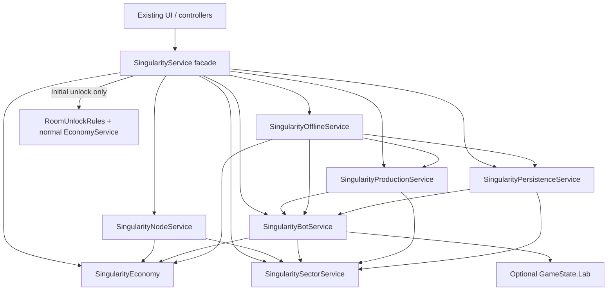
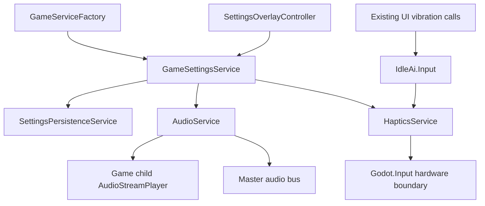

# Idle AI service refactor

## Scope and baseline

Analysis performed on branch `refactor/services`, with a clean initial working tree. This is an incremental refactor of the working Godot 4.x C# game. Inspection covered the first-party C# inventory in `Game.cs`, `scripts/game`, `scripts/data`, `scripts/persistence`, and `scripts/ui`, including partial classes, constructor dependencies, state mutations, persistence entry points, and scene/plugin configuration. Third-party AdMob, billing and Play Games implementations are integration boundaries, not refactor targets. Runtime behavior still requires Godot/device verification.

## Current architecture

`Game` is the scene root (`game.tscn`), composition root, frame-loop coordinator, save mapper/migrator, and normal-game offline settlement coordinator. There is no first-party service locator. The project autoloads the Play Games plugin.

| Component | Current responsibility and dependencies |
| --- | --- |
| GameState | Shared mutable normal-game state: rooms/slots, Tokens, run earnings, lifetime level, stats, prestige, lab, shop. Catalog definitions are separate from runtime room states. |
| EconomyService | Price quotes and production estimates; reads GameState, catalogs, research/prestige/shop and special-room data. Does not own all currency mutations. |
| ProgressionService | Room/slot unlocks, machine upgrades, milestone shards and total-level calculations; depends on state and economy. |
| ProductionService | Machine cycles, manual advancement animation bookkeeping, bot durability and research-point awards; depends on state, economy and pipeline. Returns earned Tokens to Game. |
| PipelineService | Pipeline simulation/upgrades and machine input; depends on state and economy. |
| InfrastructureService / QuantumService | Specialized room simulation, quotes and upgrades; depend on state. |
| BotService | Bot purchase/repair/sale, rarity RNG and cycle adjustments; depends on state and economy. |
| LabService / LabData / ResearchCatalog | Research requirements, purchases, timers and completion; LabData computes bonuses from completed research. |
| PrestigeService | Eligibility, normal-game reset and lifetime-level preservation; state plus static ProgressionService calculations. |
| ShopService | Shard spending/rewards, timed boosts, permanent upgrades and instant production; depends on state, economy and production. |
| LevelRewardService | Reward-road eligibility/claims; state and progression. Initially created inside GameUiController. |
| BotSkinService / MachineSkinService | Ownership, equipment, purchases, independent JSON saves and catalog texture application. Initially created inside GameUiController. Bot skins also grant secret-code debug Tokens. |
| GameSettingsService | Independent JSON preferences, global vibration gate, music player and Master bus mute. Initially created inside GameUiController. |
| GameUiController | Creates/wires pages and overlays, refreshes presentation, handles navigation and owns four non-UI services at baseline. |
| Game.PlayGamesAchievements partial | Deferred bootstrapping of Firebase, Play Games, Singularity and UI helpers; one-second achievement/leaderboard sync; installs sequential-room selection guard. |
| FirebaseAliasService + Leaderboards partial | Play Games server-code exchange, Firebase authentication/token refresh, usernames/Firestore alias operations and custom leaderboards. Godot Node with HTTP/timer lifecycle. |
| GooglePlayGamesAchievementService | Native authentication, achievement eligibility/pending confirmations and official leaderboard synchronization. |
| GooglePlayBillingService | Native billing lifecycle, purchase-token deduplication and persistent consumable ledger. Created by IapShopController. |
| ShopController / IapShopController | Rewarded-ad lifecycle and purchase grant/save/finalization sequencing respectively, mixed into presentation. |
| SingularityService | Separate Matter economy, grid/sector/node/core rules, bots, simulation, pause/resume/offline settlement and independent JSON persistence. |
| SingularityController partials | Dynamic UI, navigation, pan physics, bot presentation; owns runtime update/lifecycle bridges calling SingularityService. |

Startup order is significant: service construction (including cosmetic loads and settings/music), default room-state creation, normal UI construction/reparenting, lab/mobile UI, save timer, main load/migration/offline/research, production preparation, UI refresh, initial save. Deferred features initialize afterward. Shop prewarming waits two process frames; rewarded ads initialize on explicit video request.

## Problems and boundaries

- Service ownership is split between Game, UI controllers and deferred feature bootstraps. Cosmetic/settings constructors have side effects, making initialization order part of the contract.
- Game combines orchestration, JSON DTO mapping, version migrations and offline research/boost settlement. Keep these intact until their behavior has regression coverage.
- Currency writes occur in Game, progression, bots, lab, shop, rewards, skins and special-room upgrade services. Stats bookkeeping differs intentionally: secret-code Tokens do not count as normal earned/run Tokens. A generic grant operation must not erase those distinctions.
- Settings mixes persistence/preferences with Godot audio. `IdleAi.Input` shadows Godot.Input to gate vibration via static `GameSettingsService.IsVibrationEnabled`. Retain that API during incremental cleanup.
- Skin services duplicate temporary-file persistence and modify shared catalog textures. Combining them wholesale would risk distinct room/equipment semantics and separate save ownership.
- Large services include EconomyService, ProgressionService, SingularityService and external integrations. Size alone does not justify splitting tightly related formulas or rules.
- UI contains integration/business policy: ShopController chooses the ad reward and guards duplicate grants; IapShopController coordinates grant, main save and billing completion; secret-code policy lives in SecretKorpoSkinController; seasonal pricing in HalloweenOfferShopController; SingularityMapExtension checks Room 4 eligibility; MachineDetailsOverlay selects level versus tier upgrade operations. Extract these individually after service ownership is stable.
- Room unlock gating is enforced both in presentation/RoomUnlockRules and through a deferred Game event-wrapper replacement. Audit all entry points before consolidating it.
- Pure constructor dependencies have no identified service-to-service cycle: state -> economy -> pipeline/progression/bots -> production -> shop; level rewards -> progression. There is lifecycle coupling back through root Nodes, shared state, events and static catalogs. Avoid introducing a container or event bus to solve that coupling.
- LabData, ShopData and PrestigeData already contain domain calculations. Keep their public APIs; do not duplicate those formulas in newly named services.

Do not refactor scene hierarchy/reparenting, node paths, animation/pan/touch helpers, catalogs/GameConfig, bot RNG, production arithmetic, native plugin code, deferred startup, sync intervals, or purchase/ad callbacks in phase 1. Preserve separate Singularity update and offline paths.

## Target architecture

Game remains the explicit composition/lifecycle root. UI receives existing service instances and emits the same events. Add abstractions only for concrete boundaries, without a DI framework or global service registry.

```text
Game (composition, lifecycle, frame ordering, UI event coordination)
  GameState + existing catalogs/data
  EconomyService (quotes; later explicit currency operations)
  ProgressionService -> EconomyService
  LevelRewardService -> ProgressionService
  PipelineService -> EconomyService
  ProductionService -> EconomyService + PipelineService
  BotService -> EconomyService
  InfrastructureService / QuantumService
  LabService (existing research service; retain name)
  PrestigeService
  ShopService -> EconomyService + ProductionService
  BotSkinService / MachineSkinService (retain separate equipment models)
  GameSettingsService -> future AudioService
  future OfflineEarningsService -> state + EconomyService + LabService
  future SaveService (mapping/migration) -> existing SaveManager (Node/file adapter)
  deferred integration adapters (existing names/APIs)
  deferred SingularityService (separate state/save/simulation)
  UI controllers (explicit dependencies)
```

Do not create duplicate ResearchService, AchievementService or SkinService solely to match a generic list. Later isolate Firebase authentication and leaderboard operations behind its existing facade; retain the native achievement/billing services. A small rewarded-ad adapter is justified later because UI currently owns the SDK lifecycle.

## Phased migration

Each phase is a separate reviewable patch, must compile, and uses REFACTOR_TEST_CHECKLIST.md. Do not proceed automatically beyond phase 1.

1. **Composition ownership:** create cosmetic/settings/reward services in Game and inject them into GameUiController. Preserve old public constructor for compatibility, service creation order, scene children and all service bodies. No container needed.
2. **Settings/audio:** move player/bus operations into AudioService behind the existing settings facade. Preserve settings DTO/path, default booleans, music asset, -8 dB volume, Finished looping, mute/stop/restart behavior and vibration gate.
3. **Currency:** incrementally introduce explicit earned/offline/grant/spend operations through economy; migrate one caller group at a time. Preserve amounts, rounding, stats categories and run-earnings distinctions.
4. **Progression/rewards:** consolidate room eligibility entry points without changing unlock/claim rules or total-level formulas; keep LevelRewardService separate.
5. **Research:** separate time access from LabService only where needed for reproducible tests; keep catalog, bonuses and completion order unchanged.
6. **Prestige:** clarify reset ownership using existing reset methods; preserve all retained/reset fields and lifetime-level offset.
7. **Offline:** extract normal-game settlement verbatim, covering boost expiration, research completion split, cold load and in-process mobile resume. Keep Singularity settlement separate initially.
8. **Save:** extract DTO mapping and existing migrations behind a SaveService only if still useful. Leave SaveManager's file recovery/overwrite lock intact. No schema change planned.
9. **Integrations:** small separate steps for rewarded ads, billing grant coordination, Firebase auth/aliases/leaderboards and achievement polling. Device verification required for each. Singularity decomposition is optional later work, not bundled with integration changes.

## Save compatibility inventory (before implementation)

Main save uses reflection-based System.Text.Json serialization/deserialization with PascalCase property names and indented output. `SaveJsonContext` exists but SaveManager does not use it; switching serializers is outside phase 1. Main version remains **21**.

| Store | Owner / contents / write behavior |
| --- | --- |
| user://idle_ai_save.json | Game maps state; SaveManager reads/writes. Ten-second autosave plus action saves, initial save, exit and mobile pause/resume. Temp file flushed to disk before move; previous readable main copied to idle_ai_save.bak.json. |
| user://idle_ai_save.bak.json | Backup fallback restores main when possible. If both existing files fail to load, LastLoadFailed blocks overwrite until DeleteSave. Temporary file idle_ai_save.tmp.json is not a load fallback. |
| user://idle_ai_settings.json | GameSettingsService version 1: SaveVersion, VibrationEnabled=true, SoundEnabled=true. Temp idle_ai_settings.tmp.json then overwrite move. Survives prestige. |
| user://idle_ai_cosmetics.json | BotSkinService version 1: SaveVersion, OwnedSkinIds, EquippedBotSkinId. Temp idle_ai_cosmetics.tmp.json. Case-insensitive runtime ownership; only known catalog IDs restored, default skin fallback. |
| user://idle_ai_machine_skins.json | MachineSkinService version 1: SaveVersion, OwnedSkinIds, EquippedSkinByRoom (string room-index keys). Temp idle_ai_machine_skins.tmp.json. Known/owned/complete matching-room equipment restored. |
| user://idle_ai_iap_ledger.json | GooglePlayBillingService: ProcessedPurchaseTokens list (sorted on write), no version field. Temp idle_ai_iap_ledger.tmp.json flushed before move. Preserve purchase deduplication and grant/save/finalization ordering. |
| user://singularity_save.json | SingularityService version 4: separate JSON, case-insensitive read, direct Godot.FileAccess write. No main-save backup/lock. |

Firebase auth credentials/tokens and alias caches are runtime state in FirebaseAliasService; usernames/aliases and custom scores are remote Firestore data, not main-save fields. Play Games auth/achievements/official scores are native/remote state. Do not copy those into gameplay DTOs.

### Complete main persisted DTO properties

- `SaveGameData`: `SaveVersion` (int), `Tokens` (double), `RunEarnedTokens` (double), `LifetimeLevelBase` (int), `LastSaveUnix` (long), `IncomePerSecond` (double), `CurrentRoomIndex` (int), `AiCores` (long), `PrestigeCount` (int), `LabUnlocked` (bool), `ResearchPoints` (double), `CompletedResearch` (List<string>), `ActiveResearchId` (string?), `ActiveResearchEndUnix` (long), `DataShards` (double), `HighestClaimedLevelReward` (int), `ShopProductionBoostEndUnix` (long), `ShopBotLuckBoostEndUnix` (long), `ShopProductionUpgradeLevel` (int), `ShopOfflineUpgradeLevel` (int), `Rooms` (List<RoomSaveData>), `Stats` (StatsSaveData).
- `RoomSaveData`: `Unlocked` (bool), `DataShardUnlockRewardClaimed` (bool), `Pipeline` (PipelineSaveData?), `Infrastructure` (InfrastructureSaveData?), `Quantum` (QuantumSaveData?), `Slots` (List<SlotSaveData>).
- `PipelineSaveData`: `ComputeLevel` (int), `DataLevel` (int), `ModelLevel` (int), `OutputLevel` (int), `RawInputBuffer` (double), `ComputeBuffer` (double), `DataBuffer` (double), `ModelBuffer` (double), `ComputeCycleRemaining` (double), `DataCycleRemaining` (double), `ModelCycleRemaining` (double), `OutputCycleRemaining` (double).
- `InfrastructureSaveData`: `PowerLevel` (int), `CoolingLevel` (int), `StorageLevel` (int).
- `QuantumSaveData`: `Stability` (double), `Energy` (double), `OverclockIndex` (int), `StabilizerLevel` (int), `EnergyCoreLevel` (int), `AmplifierLevel` (int), `RecoveryMode` (bool).
- `SlotSaveData`: `Unlocked` (bool), `MachineTier` (int), `MachineLevel` (int), `ClaimedDataShardMilestones` (List<int>), `BotRarity` (BotRarity?), `BotPurchasePrice` (double), `BotDurabilityInitialized` (bool), `BotDurabilitySecondsRemaining` (double), `IsRunning` (bool), `CycleRemaining` (double).
- `StatsSaveData`: `TotalEarned` (double), `OfflineEarned` (double), `TotalSpent` (double), `SlotUnlockSpent` (double), `MachineSpending` (Dictionary<string, double>).

Lists/dictionaries preserve the existing DTO defaults. Stage/system/core levels default to 1, Quantum stability/energy use GameConfig defaults. BotRarity is the existing nullable numeric enum. RuntimeCycleDuration and manual advancement animations are not persisted. SlotData restores cycle state and initializes old bot durability through BotDurabilityInitialized, retaining save version 21. PipelineData, InfrastructureData, QuantumData and StatsData own their existing ToSaveData/LoadFromSaveData mappings and clamps.

### Singularity persisted properties

- SingularitySaveData: SaveVersion, Unlocked, Matter, CoreLevel (legacy), CurrentSectorIndex, LastSaveUnix, Sectors.
- SingularitySectorData: Nodes, CoreUnlocked, CoreLevel.
- SingularityNodeData: Type (numeric enum), Level, InvestedMatter, BotRarity, BotPurchasePriceMatter, BotDurabilityInitialized, BotDurabilitySecondsRemaining. Default serializer also emits public computed getters HasBot, BotBroken and HasWorkingBot; they have no setters and are derived on load.
- Pre-v3 saves map legacy CoreLevel to sector 0, initialize other core states, and ensure sectors/nodes exist. Bot durability is initialized when missing or clamped when present. Loaded data is set to version 4. Separate offline efficiency/cap and mobile lifecycle stay unchanged.

### Main load migrations and dependent classes

Game.LoadGame preserves existing branches: before v13 initial shards; before v14 previously unlocked rooms marked reward-claimed; v16 pipeline, v18 infrastructure and v19 Quantum restoration gates (older versions reset these systems); before v20 reward-road claim default; v21 lifetime level and pre-v21 prestige/reward lower-bound migration. Pre-v19 offline base income is recomputed; newer versions use saved base income. GetMigratedOfflineIncomePerSecond retains its legacy pre-v15 boost branch, even though current caller gating makes that branch unreachable for pre-v19 saves. Do not simplify it in this phase.

Direct schema dependencies: Game, SaveManager, SaveJsonContext, SlotData, PipelineData, InfrastructureData, QuantumData, StatsData and the independent store owners above. Indirect consumers include every service/UI reading GameState, achievement/leaderboard level calculations, catalog texture users, and Singularity research bonuses.

No save fields, defaults, versions, file paths, serialization settings or migrations change in phase 1. No migration is needed. Future persistence changes must retain unknown/legacy values where relevant rather than silently discard them, and use copies of historical saves for fixtures.

## Existing risks recorded separately (no behavior fixes)

- Main read success means non-null deserialization rather than complete structural validation. Malformed nested values may fail later in mapping. Keep recovery semantics unchanged here.
- Independent cosmetic/settings stores do not share the main corruption lock; cosmetic loading filters unknown catalog IDs. Singularity catches load failures by replacing runtime data with defaults and uses direct writes. Review data-loss protection separately before any save cleanup.
- Purchase and ad workflows span UI and persistence. Moving callbacks or changing event order could duplicate or lose grants; postpone them.

## Completed phases / remaining work

Phase 1 implementation: Game constructs BotSkinService, MachineSkinService, LevelRewardService and GameSettingsService immediately before creating GameUiController, in the existing order. An internal injection constructor accepts those instances. The existing public constructor remains a compatibility entry point with its original signature and construction behavior. UI presentation, subscriptions and service algorithms are unchanged. This intentionally retains the legacy constructor's construction responsibilities for compatibility; the production Game path uses explicit injection.

Phases 2–9 remain proposed work. Godot runtime, existing-save and Android checks remain manual until checked. Build and diff results are recorded after verification below.

## Phase 1 verification results

- Baseline `dotnet build`: succeeded, 0 errors, 351 existing CS8632 nullable-annotation warnings.
- Post-change `dotnet build`: succeeded, 0 errors, same 351 CS8632 warnings. No warning-policy/project changes made.
- `git diff --check`: passed. Constructor-reference search found the production Game call and retained public/new internal constructors; no moved/renamed types.
- Compared against HEAD: Game is byte-for-byte unchanged outside CreateGameSystems; GameUiController is byte-for-byte unchanged outside its constructors. All existing service implementations, persistence/data definitions, scenes, assets, plugin configuration and gameplay constants are unchanged.
- Manual Godot, historical-save, mobile integration and Android export checks have not been run; use REFACTOR_TEST_CHECKLIST.md. No automated gameplay tests added for this construction-only phase.
- Changes remain uncommitted on `refactor/services`: two code files plus these two documentation files form a single separable phase-1 patch. No main-branch changes or unrelated user-file edits.


## Currency phase: pre-change mutation audit

Audited all first-party C# (Game.cs and scripts/**/*.cs; addon SDK code excluded).

| Original location | Mutation / bookkeeping |
| --- | --- |
| Game.AddEarnedTokens | Machine/pipeline/frame production: Tokens + RunEarnedTokens + TotalEarned |
| Game offline settlement final block | Tokens + RunEarnedTokens + OfflineEarned + TotalEarned; calculations untouched |
| Game.LoadGame / save mapping | Restore Tokens, RunEarnedTokens, DataShards (legacy initial-shard branch); serialize balances and Stats |
| ProgressionService.UnlockSlot / UnlockRoom | Tokens deduction + TotalSpent + SlotUnlockSpent |
| ProgressionService.UpgradeLevel / UpgradeTier | Tokens deduction + TotalSpent + machine-name spending; bulk deductions individually, stats once using accumulated total |
| BotService purchase / repair | Tokens deduction + TotalSpent + named Bots / Bot Repairs spending |
| BotService sale | Tokens refund only; no earnings or spending reversal |
| LabService.UnlockLab / BuyResearchPoints | Tokens deduction + TotalSpent + Laboratory / Research Points spending |
| PipelineService / InfrastructureService / QuantumService upgrades | Tokens deduction + TotalSpent + existing named stage/system/upgrade spending |
| SingularityService.Unlock | Normal Tokens deduction + TotalSpent + SlotUnlockSpent; Matter remains independent |
| ShopService.GrantDataShards | Positive integer shards; ad and IAP controllers call this facade |
| ShopService boost, luck, permanent production/offline upgrades, instant production | Shard deduction using existing ceiling(amount - 1e-9); failure refunds exact cost |
| ShopService instant production success | Tokens + RunEarnedTokens + TotalEarned |
| LevelRewardService.Claim | Fixed RewardDataShards grant; claim marker/order retained |
| BotSkinService.GrantDebugTokens | Validated secret/debug grant: balance only |
| BotSkinService / MachineSkinService purchases | Shards deducted at exact quoted price, without shop ceiling |
| PrestigeService.ResetNormalProgress | Tokens and RunEarnedTokens reset to zero; no Token/shard prestige reward |
| StatsData | Sole existing internal earned/offline/spending counters and machine dictionary mutations; save restoration |
| GameState / ShopData / SaveData | Property declarations, initial shard default, persistence DTOs |

Other monetary-looking resources audited: ResearchPoints are awarded by ProductionService and bulk machine upgrades, bought/spent by LabService, restored by Game. They remain the lab resource, outside this Token/shard phase. AiCores only restore from saves in current gameplay; prestige increments PrestigeCount. Room unlock reward flag and legacy machine shard milestone helpers do not currently grant shards; no new rewards introduced. All Singularity Matter/invested-Matter/node/bot/core mutations remain separate. UI has no direct normal currency writes: ad/IAP/secret callbacks use existing facades. External SDK lifecycle and grant -> save -> completion ordering remain untouched.

## Completed currency ownership phase

The existing EconomyService now owns normal Token and Data Shard writes. GameServices/GameServiceFactory retain explicit ownership and inject the same economy instance into the newly dependent services. Compatibility service constructors delegate to an EconomyService over the same state; they introduce no independent balance or persistence. Singularity's production caller passes the session economy to Unlock; the old Unlock signature remains compatible. Nothing else in Singularity was extracted.

New API:

- `CanAffordTokens(double)` / `TrySpendTokens(double)`
- `RecordSlotSpending(double)` / `RecordMachineSpending(string, double)`
- `AddEarnedTokens(double)` / `AddOfflineTokens(double)`
- `GrantTokens(double)` / `RefundTokens(double)`
- `CanAffordDataShards(double)` / `TrySpendDataShards(double)`
- `GrantDataShards(double)` / `RefundDataShards(double)`
- `ResetRunTokens()`

Amount validation remains at the existing domain entry points. Affordability preserves the original `balance < cost` comparison (including its non-finite edge behavior); no new clamping or rounding. Spending records remain explicit because bots/repairs/research record after their existing state transitions, and bulk upgrades record one summed amount after all individual deductions. This avoids changing floating-point aggregation. All record methods delegate to unchanged StatsData, preserving TotalSpent, SlotUnlockSpent and exact existing machine category strings. Refunds do not reduce spending statistics.

| Operation | Balance | Run earned | Lifetime earned | Offline earned |
| --- | --- | --- | --- | --- |
| Normal machine / pipeline income | + amount | + amount | + amount | unchanged |
| Instant production success | + amount | + amount | + amount | unchanged |
| Offline settlement | + amount | + amount | + positive amount | + positive amount |
| Secret/debug/admin grant | + amount | unchanged | unchanged | unchanged |
| Bot sale/refund | + refund | unchanged | unchanged | unchanged |
| Prestige reset | zero | zero | unchanged | unchanged |

Production keeps its original positive-income guards. Offline settlement still applies its final amount unconditionally, with StatsData retaining its own positive-amount guard. Offline calculation, research/boost settlement and frame ordering are unchanged. Current ad/IAP rewards grant shards through ShopService, not earned Tokens; no hypothetical Token purchase bookkeeping was added.

Shard storage remains `GameState.Shop.DataShards` as double. ShopService retains `WholeShardCost` unchanged, including finite/positive validation and `Math.Ceiling(amount - 0.000000001)`. Skin services spend exact quoted prices, including seasonal prices. Instant-production failure refunds exactly the charged whole cost. Grants retain their existing integer entry points and fixed level-reward amount; no new shard statistics, rewards or balance normalization.

Intentional remaining writes outside EconomyService:

- Game.LoadGame restores Tokens, RunEarnedTokens and DataShards, including its unchanged legacy initial-shard migration. Save hydration is not a gameplay transaction and must not generate earnings/spending.
- ShopData retains its initial-shard initializer. GameState and save DTO setters remain public as before; serialization object initializers copy balances rather than mutate gameplay currency.
- StatsData retains its internal counters/dictionary and LoadFromSaveData. Only EconomyService invokes gameplay monetary stats updates now.
- Lab ResearchPoints, legacy AiCores and Singularity Matter retain their original domain ownership; they are outside the requested Token/shard boundary.

Verification:

- `dotnet build`: succeeded, 0 errors, 353 CS8632 warnings; no project/warning policy changes.
- Temporary executable harness against the built IdleAi assembly passed earned/offline/grant/refund distinctions, failed affordability, slot/machine categories, large-number bulk aggregation, exact fractional shard debit/refund, and reset retention. Run using installed .NET 10 with major roll-forward; not a Godot/device gameplay test.
- Final currency-write/stat-call search: only economy gameplay mutations, Game hydration and existing data/DTO initialization/restoration remain.
- Reviewed full diff. All changed C# string literals match HEAD, including player messages and category keys. Save/data definitions, GameConfig, SaveManager, serializers, billing, ad/IAP callback files and scenes are unchanged. Game changes are limited to earned method removal/call migration and the final offline credit.
- `git diff --check`: passed. No save migration: main version remains 21, all independent save versions/formats/paths unchanged; historical save loading remains a manual check.
- Manual runtime/device verification remains unchecked in REFACTOR_TEST_CHECKLIST.md. Work remains on refactor/services, uncommitted.

Recommended next phase: consolidate normal progression/room eligibility entry points, retaining reward/level formulas and existing gates. Offline extraction and save extraction remain separate future work; neither is included here.


## Completed progression / room eligibility phase

Pre-change entry-point map:

- MapController room button Pressed emits RoomSelectedRequested. Its refresh reads ownership for icons/colors/labels/links and asks ProgressionService for the Lab-adjusted price.
- GameUiController forwards the request synchronously, compares ownership before/after, and animates successful new-room entry.
- Game subscribes OnRoomSelectedRequested, hides Lab, validates the target, calls UnlockRoom for unowned rooms, displays the result, selects successful/owned targets, closes pages, refreshes and saves. Failure refreshes without saving.
- Game.PlayGamesAchievements.InitializeDeferredFeatures installed InstallSequentialRoomSelectionGuard, replacing Game's subscription with OnGuardedRoomSelectedRequested. This checked RoomUnlockRules before invoking Game; direct UnlockRoom calls bypassed it.
- RoomUnlockRules checked previous-room ownership and every previous Slot, with already-owned compatibility. NavigationPolishController independently duplicated eligibility, missing-slot counts and requirement messages, and overlaid map blockers/requirement labels.
- SingularityMapExtension click and badge checked Room 4 ownership; NavigationPolishController's Singularity blocker additionally required all Room 4 slots. SingularityService.Unlock checked only ownership of Singularity and Token affordability. No Quantum machine-level, energy or upgrade completion requirement was found at this boundary.
- HandleSlotAction delegates locked slots to private UnlockSlot and owned slots to UpgradeSlot, which delegates to UpgradeMachineLevels or UpgradeMachineTier. There is no separate duplicated slot mutation to consolidate. Costs, machine initialization, milestone logic and messages remain unchanged.
- PipelineService, InfrastructureService and QuantumService gate their own activity/upgrades on their configured normal room being owned and retain their own system prerequisites. They neither unlock normal rooms nor add requirements for buying the next room; left unchanged.
- LevelRewardService depends on ProgressionService.GetTotalLevel only. Its separate 150-level / 10-shard ordered claim persistence and duplicate prevention are unchanged. Total/current-run level formulas, prestige lifetime base and all leaderboard/achievement/reward thresholds are unchanged.

Final authoritative path:

`MapController -> GameUiController -> Game.OnRoomSelectedRequested -> ProgressionService.UnlockRoom -> fresh GetRoomUnlockQuote -> RoomUnlockRules -> EconomyService.TrySpendTokens / RecordSlotSpending -> room + first-slot initialization + reward flag -> Game UI refresh / SaveGame -> UI unlock animation`.

ProgressionService adds immutable RoomUnlockQuote (valid target, ownership, progression eligibility, cost, affordability, message, CanUnlock), GetRoomUnlockQuote and CanUnlockRoom. UnlockRoom retains ProgressionResult and re-evaluates the quote itself before any debit or mutation; callers need no precheck. CanUnlockRoom means a **new purchase** is possible; AlreadyUnlocked independently permits selection regardless of prerequisites or balance. Costs still use GetRoomUnlockCost and its existing Lab multiplier. Existing insufficiency, already-owned and success messages remain unchanged.

RoomUnlockRules remains the sole pure prerequisite formula, shared by domain mutation and navigation previews. UI keeps existing blockers, labels, icons, node paths and layout; only its duplicated formulas/messages/count loop were replaced by helper calls. Map cost preview now uses the service quote. The helper's vacuous all-slots check is retained; normal rooms always initialize eight slots. No new malformed-save policy was added.

Removed the guard-installed field, deferred install call, subscription replacement and guarded callback entirely. Play Games/Firebase internals are unchanged. Game's existing coordinator already had the target responsibilities and only needed a RoomStates bounds check.

Singularity's normal boundary now shares CanUnlockSingularity, requiring the Quantum room (Room 4) and every slot, as the existing map blocker did. The final Singularity Unlock validates this before its unchanged Token cost/spending. Existing owned Singularity bypasses the prerequisite and remains selectable. The extension's ownership-only click check is removed and its badge uses the shared prerequisite. Requirement failures use shared room-name/remaining-slot messages. Matter, sectors, cores, nodes, bots and independent persistence are untouched.

Remaining normal-room writes, classified after repository search:

| Location | Classification |
| --- | --- |
| ProgressionService.UnlockRoom: roomState.Unlocked = true | Sole new normal-room gameplay unlock mutation |
| Game.CreateRoomStates: roomIndex == 0 | New-run initialization; Room 1 starts owned |
| Game.LoadGame: savedRoom.Unlocked | Save hydration; preserves older owned rooms without revalidation |
| PrestigeService.ResetNormalProgress: roomIndex == 0 | Existing run reset; only Room 1 remains owned |
| Game.SaveGame / save DTO declarations | Serialization copies/declarations, no gameplay unlock |
| ProgressionService slot writes / Game slot initialization / prestige slot reset | Slot ownership, not room unlock paths |
| LabService and SingularityService ownership/core writes | Separate domain states, not normal rooms |

Verification: dotnet build succeeded, 0 errors, 353 existing CS8632 warnings. Temporary executable checks against the built assembly passed invalid targets, direct bypass attempts, stale-preview revalidation, insufficient balance with no mutation, Room 2 -> 3 -> 4, exact debit/TotalSpent/SlotUnlockSpent, duplicate calls, first-slot initialization/reward flag, legacy ownership and shared Singularity boundary. These are domain checks, not Godot/device tests. Final reference search found no removed guard symbols; diff review confirms unchanged constants, slot algorithms, level/reward formulas, integrations, save/data/schema/migrations and scene/node/resource paths. Main SaveVersion remains 21; no migration is required. Manual checks remain pending in REFACTOR_TEST_CHECKLIST.md.

Recommended next phase: a separately scoped OfflineProgressService extraction, preserving settlement calculations and lifecycle ordering. No offline/save extraction or later integration phase was performed here.

## Offline extraction: pre-change algorithm audit

Before extraction, Game owned cold-load settlement, three pause snapshot fields and the paused flag, research splitting, boost overlap, migration income selection and Token credits. Pause (Android/iOS only) records Unix time, economy income excluding temporary boost and boost end **before** SaveGame. Duplicate pause is ignored. Resume consumes the paused flag; invalid/nonpositive pause time or now <= pause returns without production preparation, refresh or save. Valid resume settles the in-memory snapshot, prepares production, refreshes, chooses earnings before research message, then saves. Cold load hydrates/migrates everything first, settles, prepares production, refreshes, chooses load failure > research > earnings > default, then saves.

Exact normal algorithm: elapsed = end - start, with **no maximum duration/cap**. Nonpositive elapsed or nonpositive base income pays zero. Efficiency = Clamp(0.25 + Lab offline bonus + Shop offline level * 0.05, 0, 1). Shop level maximum 15, base cost 35 and growth 1.60 remain unchanged; the upgrade is additive efficiency, not a separate production multiplier. Boosted seconds = Min(Max(0, Min(end, boostEnd) - start), elapsed). Normal seconds = elapsed - boosted seconds. Amount = (baseIncome * normalSeconds + baseIncome * boostedSeconds * ShopTemporaryProductionMultiplier) * efficiency. Preserve this operation order and one Economy.AddOfflineTokens call per positive-duration/positive-base segment, including zero efficiency. That API increments Tokens and RunEarnedTokens unconditionally; StatsData records positive amounts in both TotalEarned and OfflineEarned.

If now <= LastSaveUnix, credit zero but call Lab.Update. Otherwise, incomplete/no research pays one segment using saved base income. Due research with end > LastSaveUnix pays the pre-research segment, calls Lab.Update (which completes/clears research and refreshes cycle durations), recomputes economy income without temporary boost, then pays the post-research segment using updated efficiency. Research already due at save time completes first, then uses recomputed income for the whole interval. Each segment independently splits boost overlap; no approximation or aggregate credit. Lab locked state does not add a completion gate. Invalid active research is cleared with its existing message.

Compatibility: saves <19 use hydrated/migrated economy income without temporary boost; >=19 use stored IncomePerSecond. The stored-income helper retains the <15 branch dividing positive stored income by the temporary multiplier only when boost end > LastSaveUnix and multiplier >0; the <19 selection currently bypasses that helper for those saves. SaveGame stores income excluding temporary boost, current LastSaveUnix and current boost end. No timestamp is changed by settlement. Production.PrepareAfterLoad clears manual animations, resumes working bots and repairs invalid cycle remaining times; it remains orchestration after settlement, not domain calculation. Singularity's independent capped offline system is outside this algorithm.

## Completed normal offline service extraction

OfflineProgressService explicitly depends on GameState, the session EconomyService and LabService. GameServices owns it alongside the existing services; GameServiceFactory still composes the session. Public API: `CapturePauseSnapshot(long nowUnix)`, `IsPaused`, `ApplyFromSave(SaveGameData, long nowUnix)`, and `ApplyResume(long nowUnix, out OfflineProgressResult)` (false means no lifecycle follow-up). Immutable OfflinePauseSnapshot contains Unix, BaseIncomePerSecond and ProductionBoostEndUnix; it is consumed on resume and never serialized. OfflineProgressResult contains only OfflineEarned and ResearchResult.

Cold load: Game hydrates/migrates the unchanged DTO, passes it and current time to ApplyFromSave, then prepares production, refreshes/messages and saves in the original order. Mobile: Game guards Android/iOS and initialized save manager, captures once before saving, then delegates resume; successful settlement precedes production preparation, UI refresh/messages and save. Invalid/repeated/no-pause resume returns immediately. LabService.Update(long nowUnix) supplies deterministic completion time; its existing Update() remains the real-time entry point. Research completion effects, cycle refresh, messages and requirements are unchanged. All segment arithmetic and historical selection/helper branches above are retained.

SaveManager, schema, mapping, backups, corruption lock, SaveVersion 21 and migrations remain owned by their existing code. Settlement does not write timestamps or save files. Singularity lifecycle, Matter, cap, efficiency and independent save remain untouched. No UI enters the domain service.

Deterministic harness: `dotnet build`, then `dotnet run --project tests/OfflineProgress/OfflineProgress.csproj` (installed .NET 10). The standalone executable references the built game assembly and GodotSharp metadata; it constructs domain state without scenes, textures or Godot UI. Source uses .cs.txt to stay outside game compilation; the game project excludes test generated C# files. Exact double equality checks cover interval/boost/efficiency arithmetic, research production and efficiency changes, invalid research, historical saves, legacy helper, lifecycle consumption, cold/resume equivalence and all earned counters. Device/UI checks remain manual.

Recommended next major refactor: a separately scoped save orchestration service, preserving DTO mapping, migrations, backup recovery and corruption protections; no save refactor was performed here.

Final verification: `dotnet build` succeeded with 0 errors and 353 existing CS8632 warnings. Standalone harness passed 663 deterministic assertions. Migration helper and interval calculation were compared against HEAD and match verbatim. Game.cs search found none of the five removed calculation/pause symbols. First-party search found one normal settlement implementation; LabStatusView's efficiency reference is a display preview. Full changed-source/test/documentation diff reviewed; save schema/SaveVersion, SaveManager, balancing, research catalog, economy prices, Singularity and external integrations unchanged. `git diff --check` passed. Manual device/runtime checks above remain pending; changes are uncommitted on refactor/services.

## Main-save audit before extraction

Before this phase, Game.SaveGame constructed every top-level and room DTO and delegated leaf mapping to SlotData, PipelineData, InfrastructureData, QuantumData and StatsData. Game.LoadGame assigned balances, Lab, Prestige and Shop directly, restored rooms/slots, clamped navigation, restored stats and migrated lifetime levels, then called OfflineProgressService. SaveManager handled DTO/disk conversion and recovery.

Existing compatibility rules (recorded before moving code):

| Version/condition | Existing behavior |
| --- | --- |
| <13 | Replace saved DataShards with GameConfig.InitialDataShards. |
| <14 | For restored rooms, room reward claimed is true for room 0 or an unlocked room. |
| <16 or null Pipeline | Reset Pipeline; otherwise load its DTO. |
| <18 or null Infrastructure | Reset Infrastructure; otherwise load its DTO. |
| <19 or null Quantum | Reset Quantum; otherwise load its DTO. |
| <20 | HighestClaimedLevelReward becomes 0; >=20 clamps it to >=0. |
| <21 | Start LifetimeLevelBase at 0. With PrestigeCount >0 and a positive restored highest claim, set base to max(0, claim minus current run level). Thus only v20 normally has a usable claim for this migration. |
| >=21 | Restore LifetimeLevelBase clamped to >=0. |
| Bot absent | Clear durability initialized flag and seconds. |
| Bot present, initialized flag absent/false | Initialize full rarity-specific durability, independent of main SaveVersion. |
| Bot present, initialized flag true | Clamp seconds to [0, rarity lifetime], preserving broken bots. |
| Slot running | Restore running only with a working bot; preserve CycleRemaining; clear RuntimeCycleDuration. |
| Offline <19 | OfflineProgressService uses hydrated economy income excluding temporary boost. |
| Offline <15 helper | Retained helper divides positive saved income by temporary multiplier when boost was active at save; currently bypassed by <19 income selection. |

All top-level DTO fields are mapped, including legacy AiCores. Tokens and RunEarnedTokens are direct assignments, as are shards (except <13); no economy transactions occur. Lab completed research clears/rebuilds its set, skips blank IDs, accepts null and deduplicates; active research is assigned without completion. Stats are loaded only if non-null, and null MachineSpending becomes an empty dictionary. StatsData retains its existing dictionary ownership behavior.

Rooms and slots restore by index through min(saved count, runtime count); missing entries retain defaults and excess entries are ignored. Room unlock flags load directly, without progression transactions. CurrentRoomIndex clamps to [0, Rooms.Count-1], then falls back to 0 for a locked room. Default creation remains Game.CreateRoomStates (eight slots per room, first room and its first slot unlocked, first room reward claimed).

Pipeline loads levels >=1, nonnegative buffers/cycle times and clears its two runtime UI rates. Infrastructure levels clamp to >=1. Quantum clamps stability to [0, maximum], overclock to [0,4], levels to >=1 and energy to >=0, preserving RecoveryMode. Slot machine tier/level, price and milestones retain existing raw restoration (null milestones become empty). No other historical main hydration version branches exist. DTO initializers supply missing-field defaults; no new null/schema validation is introduced. Explicit null room/slot collections and an empty runtime room catalog are pre-existing unsupported hydration cases, left unchanged in this phase.

## Completed normal save-domain extraction

GameServices now owns GameSaveService, composed by GameServiceFactory using the existing GameState and EconomyService. Game keeps its SaveManager Node. Creation follows Game -> GameSaveService.CreateSave(nowUnix) -> SaveManager.SaveData(DTO). Loading follows SaveManager.LoadData -> GameSaveService.ApplySave -> OfflineProgressService.ApplyFromSave -> ProductionService.PrepareAfterLoad -> UI refresh/messages -> initial save, at the original lifecycle points.

Public API: `GameSaveService(GameState, EconomyService)`, `SaveGameData CreateSave(long nowUnix)`, `GameLoadStateResult ApplySave(SaveGameData)`, and constant `SaveVersion = 21`. GameLoadStateResult contains RestoredLifetimeLevelBase (before the historical lower-bound migration) and LifetimeLevelMigrated, solely to retain Game's diagnostic log values. Load diagnostics now print after hydration rather than midway through hydration; they retain their successful-load values and precede offline settlement. No separate migration layer is needed. The service restores an already initialized state; it does not create fresh defaults, perform currency transactions, complete research, grant rewards, trigger prestige or settle offline earnings.

All compatibility branches in the audit table remain verbatim in the save service or existing leaf data helpers. Leaf ToSaveData/LoadFromSaveData methods intentionally remain in SlotData, PipelineData, InfrastructureData, QuantumData and StatsData; the service coordinates them. No schema/property/default/version changes or player migrations were introduced. Existing normalization still means malformed DTOs need not round-trip byte-for-byte.

SaveManager is entirely unchanged: paths, main/backup/temp files, flush, backup creation/restoration, serialization/deserialization/options, corruption lock/LastLoadFailed, timer/autosave event and deletion. Game retains the 10-second autosave setup, corruption guard, HasSave/LoadData null handling, save-success diagnostics, current clock and all lifecycle/action/integration save callbacks. No field mapping, version comparison, room/slot hydration or DTO construction remains in Game. SaveVersion is read there only for logging; runtime balances/claim/base are read only for diagnostics in SaveGame/LoadGame. Default RoomState creation remains in Game and is not hydration.

Independent stores deliberately untouched: idle_ai_settings.json (GameSettingsService), idle_ai_cosmetics.json (BotSkinService), idle_ai_machine_skins.json (MachineSkinService), idle_ai_iap_ledger.json (billing), singularity_save.json (SingularityService). Singularity retains its version, Matter, sectors/cores/nodes/bots and offline system. Rewarded-ad and IAP grant -> save -> finalization sequences are unchanged.

Post-refactor search classification (first-party production C#): `new SaveGameData` occurs in GameSaveService for the main snapshot and OfflineProgressService for an in-memory resume settlement input. Main hydration version checks occur only in GameSaveService; <19 income selection and >=15 helper gating remain in OfflineProgressService. Calls to leaf ToSaveData/LoadFromSaveData occur only in GameSaveService; their definitions remain in data classes. Separate-store SaveVersion assignments remain with those stores and Singularity. SaveManager and SaveJsonContext reference DTO types for unchanged serialization infrastructure. Tests construct in-memory DTO fixtures; no personal/player save data is included.

New tests live in tests/GameSave: GameSave.csproj, Program.cs.txt, Runner.cs, Runner.tscn and project.godot (Godot may generate Runner.cs.uid). This isolated headless Godot project references the built game assembly. BotCatalog's static texture loads require a native Godot host; Runner supplies in-memory texture resources at those paths, leaving real numeric rarity definitions intact. Tests use explicit fixture expectations and recursive per-property DTO comparisons, not file or JSON formatting tests. The standalone OfflineProgress harness remains unchanged.

Run from repository root:

```sh
dotnet build
dotnet build tests/GameSave/GameSave.csproj
XDG_DATA_HOME=/tmp/idle-ai-save-tests godot-mono --headless --path tests/GameSave
dotnet run --project tests/OfflineProgress/OfflineProgress.csproj
```

GameSave passes 3,416 assertions: full current DTO roundtrip and save/load/save, exact balances/run/stats/Lab/research/Prestige/lifetime/shop fields, four rooms/eight slots, all bot rarities/durability states, cycles/milestones, all special-room DTOs, version boundaries 0/1/12/13/14/15/16/17/18/19/20/21, lifetime lower-bound guards, missing/null fields, null special-room resets, count truncation, index clamp/locked fallback, leaf clamping/runtime clearing, snapshot copies and existing stats dictionary ownership. Repeated hydration verifies no currency stats/rewards/prestige/offline settlement. Integrated historical/current offline checks prove settlement remains subsequent; existing OfflineProgress suite passes 663 assertions. A whitespace-normalized comparison against pre-refactor Game confirms creation and hydration are identical after removing logging, diagnostics bookkeeping and replacing clock access with the supplied argument.

Recommended next major refactor: isolate gameplay action orchestration currently in Game (result handling, refresh and action-triggered saves) from UI wiring, with existing domain services and persistence boundaries retained. Device/runtime checks remain pending in REFACTOR_TEST_CHECKLIST.md.

Final phase verification: `dotnet build` succeeded with 0 errors and 353 existing CS8632 warnings. The headless test project build succeeded with 0 warnings/errors. Final runs passed 3,416 persistence and 663 offline assertions. `git diff --check` passed. Full tracked diff and new service/test sources reviewed; SaveManager, all data/DTO classes, offline formulas, room/slot defaults, balance/reward/level formulas, independent stores, Singularity and external SDK code have no changes. Work remains uncommitted on refactor/services.

## Singularity audit (before extraction)

The old 2,563-line facade owned normal unlock eligibility/Token spending, Matter balance/spend/refunds, sector creation/access/current selection, Core unlock/upgrade/output, spiral grid/cache/index, node unlock/build/upgrade/sale/investment, local and cross-sector neighbors, Compute output, Amplifier/Cooling adjacency, Quantum multipliers, bot purchase/rarity/durability/repair/sale/power, aggregate/frame production, offline settlement/pending rewards/pause/resume, independent JSON/file persistence and migrations, Changed and all action messages.

Compatibility observations: locked defaults still install Sector 0 Core; GetSector ensures sectors and normalizes node counts; SelectSector saves without Changed; Update produces before durability consumption and never notifies/saves; actions mutate -> Save -> Changed once; failed actions do neither. Resume saves even with zero income and notifies only positive income. Startup randomizes -> loads/migrates -> ensures Sector 0 -> rebuilds grid -> settles offline -> saves only positive earnings. Offline recalculates at each bot break, at 50% and seven days maximum. Save failures warn and still allow action notification. Corruption falls back to defaults. No schema or balance changes are authorized.

First-party public-member call-site inventory (identical after extraction):

Game.PlayGamesAchievements constructs SingularityService(GameState) and passes that facade to controllers; it calls no additional members.

- scripts/ui/NavigationPolishController.cs: Unlocked
- scripts/ui/room/SingularityMapExtension.cs: Changed, Unlock, Unlocked, TestUnlockTokenCost
- scripts/ui/room/SingularityController.cs: NodesPerSector, BuildNode, CanUnlockNextSector, Changed, ConsumePendingOfflineEarnings, CoreCount, CurrentSectorIndex, GetBuildCost, GetFrontierSectorIndex, GetNextSectorUnlockCost, GetNode, GetNodeDisplayedOutput, GetNodeSellRefund, GetNodeUnlockText, GetNodeUpgradeCost, GetSector, GetSectorCoreLevel, GetSectorCoreOutputPerSecond, GetSectorCoreUnlockCost, GetSectorCoreUpgradeCost, GetSectorOutputPerSecond, GetTotalOutputPerSecond, HandleApplicationPaused, HandleApplicationResumed, IsNodeTypeUnlocked, IsSectorCoreUnlocked, Matter, Save, SectorCount, SelectSector, SellNode, UnlockNextSector, UnlockSectorCore, Unlocked, Update, UpgradeNode, UpgradeSectorCore
- scripts/ui/room/SingularityController.SmoothPan.cs: CurrentSectorIndex, SectorCount
- scripts/ui/room/SingularityController.Bots.cs: NodesPerSector, BuyNodeBot, CurrentSectorIndex, GetNode, GetNodeBotDurabilityRatio, GetNodeBotEffectiveMultiplier, GetNodeBotPurchaseCost, GetNodeBotRarityChances, GetNodeBotRepairCost, GetNodeBotSellRefund, RepairNodeBot, SectorCount, SellNodeBot
- scripts/ui/room/SingularityController.NodeTouchStyles.cs: Changed, GetSector

All original public methods/properties/constants/events, including unused compatibility aliases and static Core output, remain available.

## Singularity component extraction

SingularityService remains the sole public entry point. Its 2,563 lines are now 366 lines of facade API, normal unlock orchestration, frame orchestration, initialization and notification ordering. No UI/controller, scene, image, navigation, balancing, DTO, main-game service or external integration was changed.



All seven components and the facade share the same SingularitySaveData instance, including its original sector/node objects. No second runtime state model exists. Persistence copies the seven root DTO properties into that shared instance on load; it keeps the deserialized sector/node objects. Component construction has no domain mutations before the randomized Bot RNG is ready. Startup retains load/migrations -> ensure Sector 0 -> rebuild index -> settle LastSaveUnix -> save positive offline earnings. Internal optional clock/roll delegates allow deterministic tests; the public constructor still uses Godot time and a randomized Godot RandomNumberGenerator.

| File under scripts/game/singularity | Owner / responsibilities |
| --- | --- |
| SingularityEconomy.cs | Sole runtime Matter writer: CanAfford, TrySpend, GrantProduction, Refund; retains original comparison and arithmetic semantics. No normal currency or stats. |
| SingularitySectorService.cs | Sector creation/access, first-Core installation, current sector, frontier progression, Core unlock/upgrade/cost/levels/count, deterministic spiral cache and grid lookup, reciprocal cardinal cross-sector neighbor relationships. |
| SingularityNodeService.cs | Type unlock thresholds/text, global built count, build/upgrade costs and investment, legacy investment estimate, sale restrictions and one-third refund. Bot removal uses the Bot component's static clearing helper. |
| SingularityBotService.cs | Purchase prices/storage, rarity probabilities/research and RNG, durability initialization/work/breakpoints, repair prices/20% full repair, one-third sale, working multiplier and +0.10 resonance. Only this component receives optional LabData, rather than whole GameState. |
| SingularityProductionService.cs | Core output/scaling and Compute Core multiplier, base Compute output, local ring adjacency, external adjacency, Amplifier and Cooling factors, sector Quantum sum, bot effects, per-node display output, sector and total output. Original expression grouping and multiplication/accumulation order remain unchanged. |
| SingularityPersistenceService.cs | Independent user://singularity_save.json store, SaveVersion 4, original indented/case-insensitive JSON options, file read/write and warnings, LastSaveUnix, pre-v3 Core and bot durability migrations/normalization. No backup/temp/recovery scheme added. |
| SingularityOfflineService.cs | 50% efficiency, seven-day cap, durability-aware chunks ending at each bot break, Matter settlement, pending startup earnings, pause timestamp/resume reset/save and positive-income notification. Independent of normal OfflineProgressService. |

The existing SingularitySaveData, SingularitySectorData and SingularityNodeData are unchanged. Persistence retains missing-file defaults, corrupt-file warning/fallback, null JSON/default behavior, migration order, timestamp-before-serialization/write and catch boundaries. It does not use GameSaveService or SaveManager. Runtime Matter transactions never touch Tokens or Data Shards; normal initial unlock still checks RoomUnlockRules and spends/records normal Tokens through EconomyService. Lab effects are read live from the original optional Lab reference through the Bot component; production obtains those bot effects from that component.

Public API remains unchanged: unlock overloads; Update; sector/node access; Core status/level/cost/output/multiplier and upgrade/unlock aliases; node unlock/text/build/cost/upgrade/sale/refund; all bot cost/rarity/durability/multiplier/purchase/repair/sale methods; sector frontier/unlock/select/previous/next; displayed/sector/total production and built count; pending-offline consumption/pause/resume; Save; existing constants/properties and Changed. Static GetCoreOutputPerSecond(int) and compatibility aliases BuyNextCore/GetNextCoreCost/UpgradeCore remain. Call-site inventory above was searched again after extraction; no public caller needs a change.

Mutation components invoke facade callbacks at the original SaveAndNotify positions. SaveAndNotify still calls Save before Changed even when Save catches an error. SelectSector saves without notification. Frame Update computes and grants full-frame output before consuming bot work; it never saves/notifies, and it intentionally retains the existing distinction from offline breakpoint simulation. Resume clears its pause timestamp, saves, then notifies once only if income was positive. Read-only queries never raise Changed, including legacy GetSector ensure behavior.

Post-extraction search classification:

- `_data.Matter +=` / `-=`: only SingularityEconomy (production/refund credits and TrySpend); the only separate assignment is DTO hydration in Persistence.Reset. The facade reads Matter and delegates transactions.
- `FileAccess`, `JsonSerializer` and JSON options: only SingularityPersistenceService within this domain. Other independent/main stores and test fixture file/JSON code remain separate owners.
- `RandomNumberGenerator`: only SingularityBotService within this domain; runtime still randomizes once and uses Randf. Test-only roll delegates do not change runtime RNG.
- `ApplyOfflineIncomeFromTimestamp`: implementation and resume call only in SingularityOfflineService; facade invokes it once after constructor load. Normal offline implementation remains separate.
- `SaveAndNotify`: only facade implementation and callback wiring; components call their supplied callback at the original action points.
- Spiral/grid cache fields and grid/index neighbor lookup: only SingularitySectorService. Production asks that component for cross-sector neighbors; it does not limit buffs to the current sector or require the neighbor's Core online.
- Bot durability mutation: runtime initialization/clear/work in SingularityBotService; load-time compatibility clamp in SingularityPersistenceService. DTO declarations/normal bots/test fixture writes retain their own scope.

New regression harness: tests/Singularity/{Singularity.csproj,Program.cs.txt,Runner.cs,Runner.tscn,project.godot}; AssemblyInfo.cs grants only the Singularity test assembly internal access. The headless native Godot host is needed for BotCatalog; Runner supplies in-memory bot textures while keeping the real catalog values. Domain fixtures use explicit clock/roll inputs and independent expected costs/formulas. File tests use an isolated test project/profile and a fixed test timestamp, never player saves. The deliberately corrupt fixture emits the existing load warning.

```sh
dotnet build
dotnet build tests/Singularity/Singularity.csproj
XDG_DATA_HOME=/tmp/idle-ai-singularity-tests godot-mono --headless --path tests/Singularity
dotnet run --project tests/OfflineProgress/OfflineProgress.csproj
dotnet build tests/GameSave/GameSave.csproj
XDG_DATA_HOME=/tmp/idle-ai-save-tests godot-mono --headless --path tests/GameSave
```

The Singularity harness covers all 37 requested regression areas, plus all four cardinal Amplifier boundaries, locked-neighbor compatibility, every production type's bot effect, broken support bots, prerequisite failure, legacy investment and save-before-notify ordering. A whitespace-normalized comparison of 65 moved method bodies against the original (accounting for dependency qualification, clock/roll delegation and centralized transactions) found no algorithm changes; persistence hydration and facade constructor/unlock/frame orchestration were reviewed separately. Manual/device/performance checks remain in REFACTOR_TEST_CHECKLIST.md.

Recommended next refactor: extract Game action-result/refresh/save orchestration, retaining the established domain, economy and persistence owners. Singularity UI/map refactoring is outside this phase.

Final automated results: Singularity passes 197 deterministic assertions; existing normal offline passes 663; existing headless GameSave passes 3,416. `dotnet build` succeeds with zero errors (full compilation reports 349 existing nullable-annotation warnings; newly extracted files enable nullable annotations). Singularity test build also succeeds with zero errors; warnings concern the unavailable NuGet vulnerability-data feed and Godot's generated Main type colliding with the referenced game assembly, not test failures. The public declaration comparison found all 54 original method/constructor signatures unchanged, plus unchanged properties/constants/event. `git diff --check` passes. Work remains uncommitted on refactor/services; device/manual checks are pending.


## Settings, audio and haptics phase

### Audit before implementation

The previous GameSettingsService combined preference values, a private JSON DTO, file IO, static `_current`, music resource loading/player creation/Finished handling, and Master bus muting. `GameServiceFactory.Create` was the only first-party constructor caller, invoked in Game._Ready before the main save loads and UI construction. Searches for GameSettingsService, its setters/static property, vibration hardware calls, audio APIs and playback found no additional first-party soundtrack or SFX implementation. The addon AdMob sample has its own player, outside game composition.

Startup was: install current settings instance, load independent settings, create child IdleAiBackgroundMusic, apply Master mute, play only when enabled. Sound changes updated the value, applied Master/playback, saved, emitted Changed; vibration changes updated the value (immediately visible to the static gate), saved, emitted Changed. Identical values did nothing. There were no settings Changed subscribers. SettingsOverlayController reads values using SetPressedNoSignal and refreshes at initialization, opening, toggles and normal GameUiController refresh. Enabling vibration confirms with a pulse after the setter. All first-party UI vibration calls, including Singularity, resolve through IdleAi.Input because they share its namespace.

### New ownership



GameServices exposes Settings, SettingsPersistence, Audio and Haptics. New production files are scripts/game/{GameSettingsData,SettingsPersistenceService,AudioService,HapticsService}.cs. GameSettingsService remains the public preferences facade: VibrationEnabled, SoundEnabled, SetVibrationEnabled(bool), SetSoundEnabled(bool), Changed. Its constructor receives persistence, an audio application action, and haptics; a delegate overload allows deterministic load/save/order tests without Godot. No interfaces or service locator were added.

SettingsPersistenceService owns Load/Save, serialization, warnings and temporary-file cleanup. Production composition globalizes user://idle_ai_settings.json and user://idle_ai_settings.tmp.json. The JSON properties remain SaveVersion, VibrationEnabled, SoundEnabled; writes use SaveVersion 1, indented JSON, temporary WriteAllText then Move(overwrite: true). Missing files, null JSON, omitted properties and corruption retain the old defaults and fallback behavior. The DTO's SaveVersion has the previous implicit default 0 on absent JSON; facade writes still explicitly use 1. Load versions are not newly validated. Exceptions warn and save failures attempt temporary-file cleanup. Settings remain independent of main saves, main-save deletion and Prestige.

AudioService owns ResourceLoader/GD.Load, score.wav, the Game child player, -8.0f dB, Finished restart and Master mute. SoundEnabled is public read-only runtime policy for future SFX; this phase adds no SFX implementation. A small private ConditionalWeakTable keyed by scene root returns one AudioService per root through ForRoot. This is audio ownership caching, not a global service registry. Construction creates no player; the first SetSoundEnabled call initializes it without autoplay, then applies Master mute before playback. Further calls reuse the player. Root destruction owns the player lifecycle. No Autoload, import setting or music asset changes.

HapticsService owns an enabled boolean and an injected device action. GameSettingsService updates it before saving or notifying. Input keeps only a small compatibility reference to the active haptics gate, with an enabled fallback before composition; Input.CreateHaptics contains the sole Godot.Input.VibrateHandheld call. Every existing UI call and its parameters remain unchanged. It no longer reads a settings singleton.

Startup remains at the same composition point: construct persistence and root-scoped audio (no playback), install haptics in Input, load preferences, update haptics, apply loaded sound state (create player, mute Master, optionally play), then build the rest of the GameServices result. Disabled saved sound never briefly starts. Changed ordering and no-op setters are preserved.

Compatibility: pre-edit first-party constructor searches found only GameServiceFactory's new(root); GameUiController already takes GameServices and SettingsOverlayController takes the shared facade. Removed the unused root-taking settings constructor rather than retaining a path that could create duplicate players. Removed IsVibrationEnabled and _current after confirming Input was their only reader. Repeated facade creation with the composed audio service, and repeated ForRoot calls, cannot create another player. UI and Singularity files are unchanged.

### Verification and search classification

- tests/Settings: 47 deterministic assertions covering defaults; all four settings combinations; exact JSON names/version; legacy JSON; missing/null/partial/corrupt files; save failure cleanup; no-op setters; notification/save/runtime order; enabled/disabled load audio requests; immediate haptics policy and forwarded parameters.
- tests/SettingsAudio: 10 headless Godot assertions covering the real linked music asset, one player, -8 dB, disabled startup, root ownership reuse, repeated settings construction, Master mute/unmute, re-enable and Finished gating/restart. The harness links the existing score.wav into its isolated project and imports it there; it does not change the game asset or its import.
- Existing suites: OfflineProgress 663, GameSave 3,416, Singularity 197 assertions pass.
- dotnet build: zero errors, 344 existing CS8632 warnings. Test restore may report NU1900 because the NuGet vulnerability feed is unavailable; assertions run successfully. Some audio harness runs emit Godot ObjectDB/resource diagnostics on engine shutdown after all assertions pass (exit code 0); a verbose rerun completed cleanly. This does not verify physical audio or mobile lifecycle behavior.

Commands:

```sh
dotnet build
dotnet run --project tests/Settings/Settings.csproj
dotnet run --project tests/OfflineProgress/OfflineProgress.csproj
dotnet build tests/GameSave/GameSave.csproj
XDG_DATA_HOME=/tmp/idle-ai-save-tests godot-mono --headless --path tests/GameSave
dotnet build tests/Singularity/Singularity.csproj
XDG_DATA_HOME=/tmp/idle-ai-singularity-tests godot-mono --headless --path tests/Singularity
XDG_DATA_HOME=/tmp/idle-ai-settings-audio XDG_CONFIG_HOME=/tmp/idle-ai-settings-config godot-mono --headless --editor --path tests/SettingsAudio --import
dotnet build tests/SettingsAudio/SettingsAudio.csproj
XDG_DATA_HOME=/tmp/idle-ai-settings-audio XDG_CONFIG_HOME=/tmp/idle-ai-settings-config godot-mono --headless --path tests/SettingsAudio
```

Post-refactor repository search: first-party AudioServer/AudioStreamPlayer and music path references belong to AudioService (plus test fixtures); the addon sample remains separate. Settings filename/JsonSerializer references belong to SettingsPersistenceService. Other JsonSerializer uses are existing cosmetics, billing, Firebase, main/Singularity save stores. Other ResourceLoader uses load fonts, UI textures, cosmetics or the main scene. IsVibrationEnabled and the exact settings _current field are gone; other _current-prefixed fields are unrelated UI/Firebase state. VibrateHandheld UI calls go through Input, then HapticsService; hardware access exists once in Input. No gameplay, Singularity, main-save schema/migration, SaveVersion 21, SaveManager, UI layout or asset changes.

Recommended next major refactor: audit Google Play Billing purchase orchestration, ledger persistence and SDK boundary for focused extraction while preserving exactly-once grants and save-before-finalization behavior. This is a future phase, not part of these changes.
